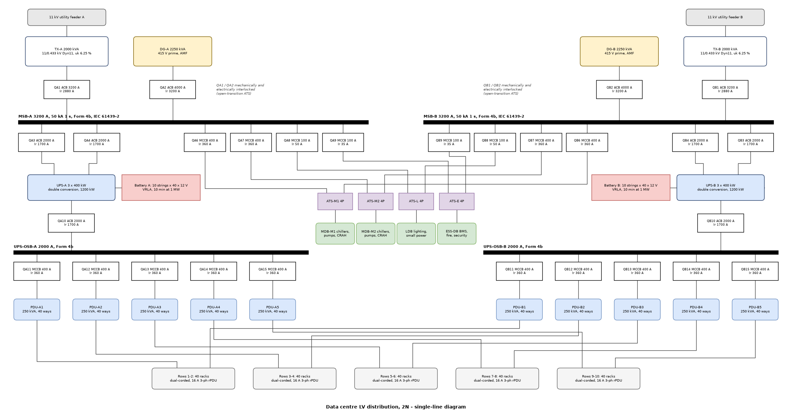
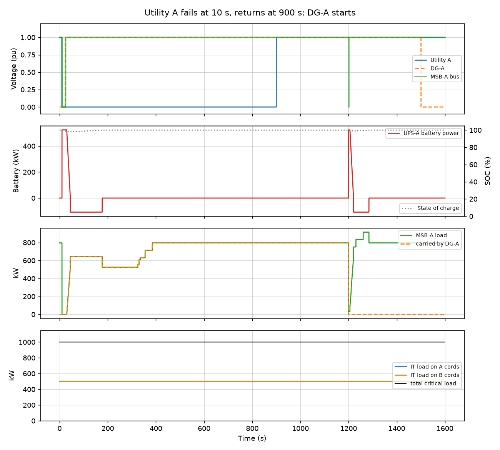
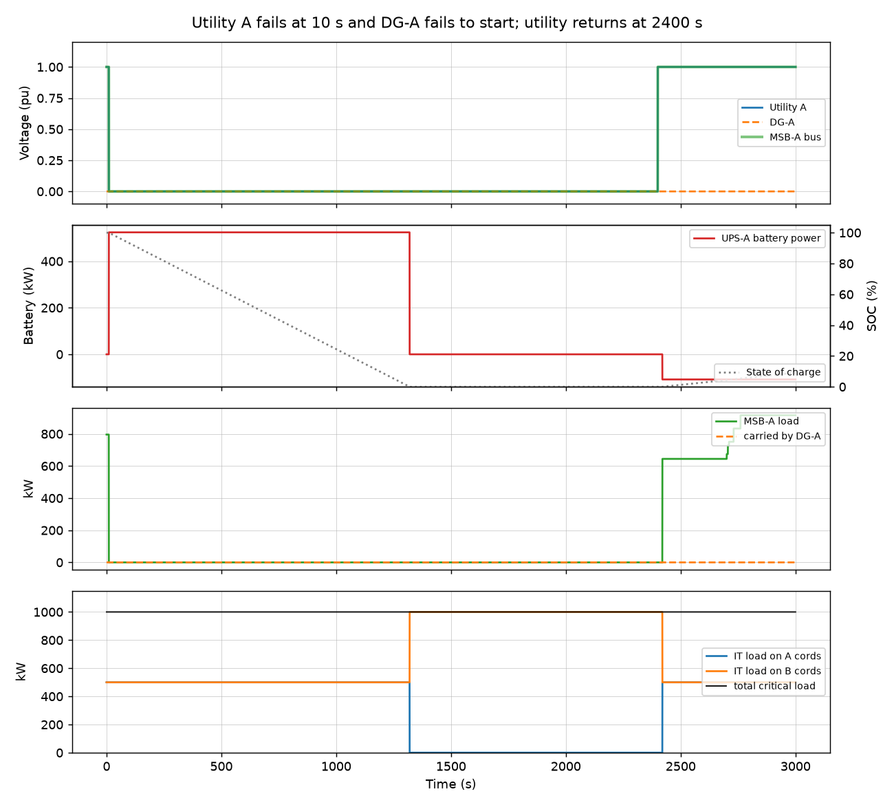

# Data Centre LV Power Distribution, 2N

LV design for a 1 MW critical-load data hall (200 racks, 10 rows) with fully
duplicated A and B power paths:

- two 11 kV utility feeders, each with its own transformer
- a diesel generator per side, changed over by an interlocked ACB pair
  (open-transition ATS) at the main LV switchboard
- a UPS system, UPS output board and five PDUs per side
- dual-corded racks, so either side can carry the whole IT load alone

The sizing, the single-line diagram and the source-transfer sequence are all
generated from one design basis ([`dcdesign/basis.py`](dcdesign/basis.py)), so a
change in load flows through every deliverable.



`drawings/sld.drawio` is the same diagram as an editable draw.io file.

## Running

```bash
pip install -r requirements.txt
python build.py
python -m pytest
```

## Design cases

Each side is checked for two conditions:

| Case | What one side carries |
|---|---|
| Normal | half the IT load (500 kW) and its own mechanical / building boards |
| Failure (other side lost) | the full 1000 kW IT load and, through the 4-pole ATSs, both mechanical boards, the lighting board and the ESS board |

The failure case sizes the equipment. The normal case shows where the system
runs day to day.

## Results (per side)

| Item | Selected | Loading |
|---|---|---|
| Transformer | 2000 kVA, 11/0.433 kV, Dyn11, uk 6.25 % | 46 % normal, 86 % failure (limit 90 %) |
| Generator | 2250 kVA prime | 77 % failure (limit 85 %) |
| UPS | 3 x 400 kW modules = 1200 kW | 42 % normal, 83 % failure |
| Battery | 10 strings x 40 x 12 V VRLA | 10 min at 1 MW, end of life |
| PDUs | 5 x 250 kVA, 40 ways each | 41 % normal, 82 % failure |
| Rack supply | 3-phase 16 A IEC 60309 rPDU per cord | 8.5 A per cord at 6 kW |
| Main LV switchboard | 3200 A, 50 kA 1 s, Form 4b | |
| UPS output board | 2000 A, Form 4b | |
| Design PUE at full IT load | 1.58 | transformer losses excluded |

### Load at the main LV switchboard

| | Normal | Failure |
|---|---|---|
| UPS input (incl. 120 kW battery recharge) | 644 kW | 1160 kW |
| Mechanical (chillers, CHW pumps, CRAH fans) | 242 kW | 483 kW |
| Lighting, small power, BMS / fire / security | 25 kW | 50 kW |
| **Total** | **911 kW, 929 kVA** | **1693 kW, 1729 kVA, 2405 A** |

The UPS efficiency comes from a part-load curve: 95.4 % at 42 % load and 96.1 %
at 83 % load. P and Q are added separately because the UPS rectifier (pf 0.99)
and the VFD/EC mechanical loads (pf 0.95) run at different power factors.

### Battery sizing

Constant-power method for the full 1000 kW on one side:

```
DC power        = 1000 kW / 0.961                  = 1040 kW
design power    = 1040 x 1.25 (ageing) x 1.10      = 1430 kW
per cell        = 1430 kW / 240 cells               = 5960 W/cell for 10 min to 1.67 V/cell
strings         = 5960 / 600 W/cell (block rating)  = 10 strings
```

The 600 W/cell figure is the 10-minute constant-power rating of the chosen 12 V
high-rate block. Swap in the selected maker's discharge table value.

### Switchgear (side A, side B identical)

| Tag | Duty | Device | Ir | Design current |
|---|---|---|---|---|
| QA1 | Transformer incomer | ACB 3200 A | 2880 A | 2782 A (transformer In) |
| QA2 | Generator incomer | ACB 4000 A | 3200 A | 3130 A (DG In) |
| QA3 | UPS rectifier input | ACB 2000 A | 1700 A | 1630 A |
| QA4 | UPS static bypass | ACB 2000 A | 1700 A | 1669 A |
| QA5 | Maintenance bypass | ACB 2000 A | 1700 A | 1669 A |
| QA6, QA7 | Feeders to mechanical ATSs | MCCB 400 A | 360 A | 354 A |
| QA8 | Feeder to lighting ATS | MCCB 100 A | 50 A | 46 A |
| QA9 | Feeder to ESS ATS | MCCB 100 A | 35 A | 31 A |
| QA10 | UPS output | ACB 2000 A | 1700 A | 1669 A |
| QA11-15 | UPS output board to PDU-A1..A5 | MCCB 400 A | 360 A | 348 A (PDU rating) |

Selection rule: frame so the design current is at most 90 % of it, Ir at the next
5 % step at or above the design current. Incomers are sized on the source rating
rather than the load. All switching is 4-pole because the TN-S system has
several sources: switching the neutral avoids circulating neutral currents and
false earth-fault trips across the ATSs.

The main LV switchboard is rated 50 kA for 1 s. The short-circuit study of the same
2000 kVA transformer (`lv-short-circuit-selectivity-study`) gives 40.5 kA at this
bus. Busbar ratings are checked against the IEC 61439-1 rated diversity factor
for the number of outgoing circuits.

## Source transfer sequence

[`dcdesign/ats.py`](dcdesign/ats.py) steps the side-A changeover logic in 0.1 s
increments: utility undervoltage detection, generator start attempts, the
interlocked QA1/QA2 transfer, UPS rectifier walk-in, the mechanical ATSs with
preferred sources, staged chiller restart, retransfer and generator cool-down.

**Utility A fails at 10 s and returns at 900 s:**

```
  10.0 s  Utility A lost, undervoltage timer started
  13.0 s  Undervoltage confirmed, DG-A start signal          (3 s rides through an auto-reclose)
  15.0 s  MDB-M1 and LDB ATSs transfer to source B           (cooling restarts on B)
  22.1 s  DG-A at rated voltage and frequency
  24.1 s  QA1 utility ACB open
  24.7 s  QA2 generator ACB closed, MSB-A on DG              (0.5 s dead time for residual voltage)
 324.7 s  MDB-M1 and LDB return to preferred source A        (on DG, staged restart)
 900.0 s  Utility A restored, 300 s stability timer
1200.0 s  QA2 open, QA1 closed 0.6 s later                   (open-transition retransfer)
1500.7 s  DG-A stopped after 300 s cool-down
```

The UPS bridges both breaks on battery, which stays above 97 %. Because
the rectifier walks in over 15 s and the chillers restart in stages, the
largest load step the generator sees is 155 kW, under 9 % of its prime rating.



**Utility A fails and DG-A fails to start.** Three start attempts fail and UPS-A
runs on battery. At half load the battery lasts about 22 minutes instead of the
10-minute full-load rating. When it is exhausted, every rack carries on from its
B cord and side B takes the full 1000 kW, which is the case the B side was sized
for. The critical load is never interrupted.



## Metering

| Point | Meter | Used for |
|---|---|---|
| Transformer incomer | Class 0.5S, power quality | utility energy, demand, THD |
| Generator incomer | Class 1 | generator kWh and loading |
| UPS input and output | Class 0.5S | UPS losses and efficiency |
| PDU incomers | Class 1 | IT energy, the PUE denominator |
| PDU branch circuits | branch circuit monitoring | rack current, capacity planning |
| Mechanical, lighting, ESS boards | Class 1 | cooling energy, partial PUE |

## Deliverables

| File | Contents |
|---|---|
| `results/load_schedule.xlsx` | summary, load schedule (both cases), breaker schedule, busbars, metering, BOM |
| `drawings/sld.drawio`, `sld.png` | single-line diagram |
| `results/ats_*.png`, `ats_*_events.csv` | transfer sequence timelines and event logs |

## Assumptions

- IT power factor 0.98; rack design maximum 6 kW against a 5 kW average.
- Mechanical loads are running kW with their own N+1 redundancy; the standby
  units are not counted.
- Battery recharge is limited to 10 % of the UPS rating and is counted in the
  UPS input.
- Transfer timings (3 s undervoltage delay, about 10 s generator start, 0.5 s dead
  time, 300 s stability and cool-down timers) are typical AMF settings and can be
  changed in `ats.Settings`.
- The simulation treats side B as healthy throughout; it checks the A side's
  logic and the 2N handover, not a simultaneous failure of both sides.
